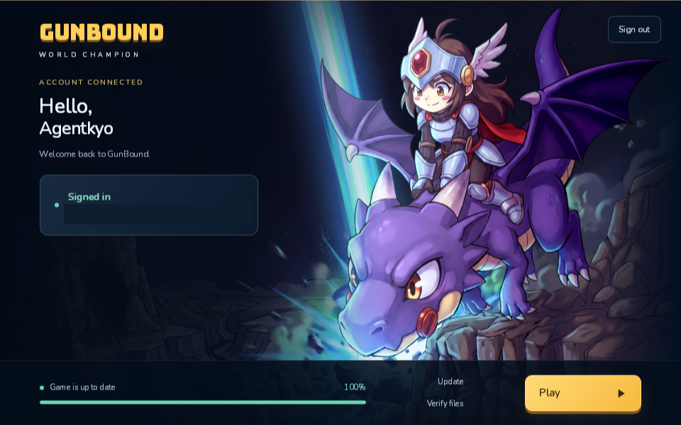
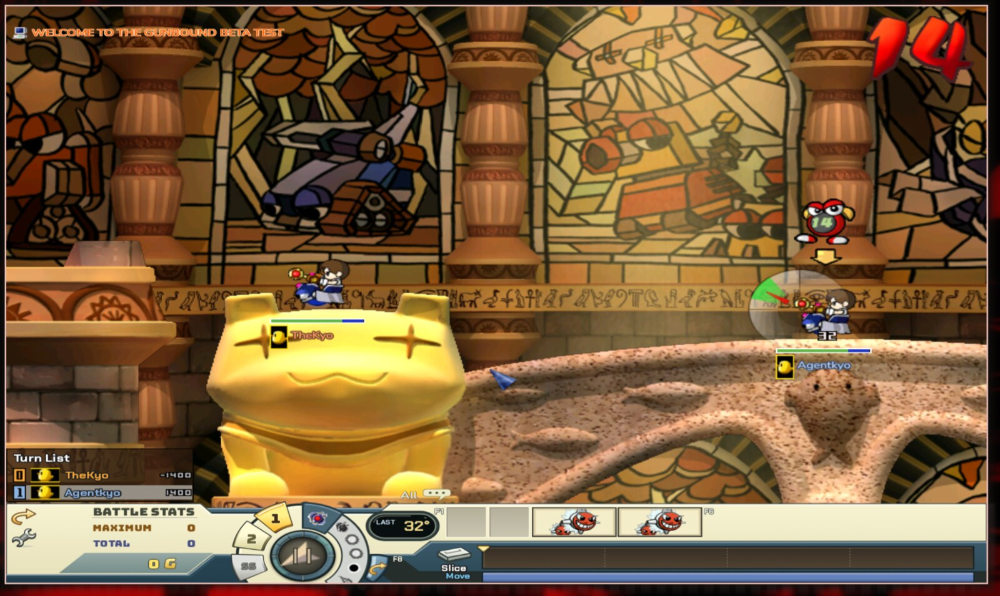

# GunBound on Linux 🐧💥

**Jogue GunBound no Linux · Play GunBound on Linux · Juega GunBound en Linux**

[🇧🇷 Português](#-português) · [🇺🇸 English](#-english) · [🇪🇸 Español](#-español)

> GunBound é desenvolvido e mantido pela equipe oficial em **[gunbound.gg](https://gunbound.gg/)**. Todo o crédito pelo jogo é deles. Crie sua conta e venha jogar! 🎯
>
> GunBound is developed and run by the official team at **[gunbound.gg](https://gunbound.gg/)**. All credit for the game goes to them. Sign up and come play! 🎯
>
> GunBound es desarrollado y mantenido por el equipo oficial en **[gunbound.gg](https://gunbound.gg/)**. Todo el crédito por el juego es de ellos. ¡Regístrate y ven a jugar! 🎯

<p align="center">
  
  
</p>
<p align="center"><sub>Launcher com sessão salva e partida rodando no CachyOS · Launcher with a saved session and a match running on CachyOS · Launcher con sesión guardada y partida en CachyOS</sub></p>

---

## 🇧🇷 Português

O GunBound está de volta, e todo mundo merece a chance de se divertir no melhor jogo online de todos, inclusive quem usa Linux. Este é um **projeto colaborativo da comunidade** que instala e configura o GunBound no Linux com o Wine, com um único comando.

### Antes de tudo: crie sua conta

1. Acesse **[gunbound.gg](https://gunbound.gg/)** e faça seu cadastro.
2. Baixe o instalador oficial (`GunBound-Setup.exe`). Pode deixar na pasta Downloads.

### Instalação

```bash
git clone https://github.com/agentkyo/gunbound-on-linux.git
cd gunbound-on-linux
./gunbound-linux.sh
```

Só isso. O script:

1. Detecta sua distribuição e instala as dependências (Wine 10 ou mais novo e curl). Ele pede sua senha (`sudo`) se precisar instalar pacotes.
2. Encontra o instalador `.exe` do GunBound na sua pasta de Downloads, na Área de Trabalho ou na pasta atual. Se não encontrar, abre o site oficial e espera o download terminar. Você também pode digitar o caminho do arquivo.
3. Cria um prefixo do Wine só para o jogo, em `~/Games/gunbound`.
4. Instala o jogo em `C:\GunBound` dentro desse prefixo.
5. Instala um pequeno componente de compatibilidade que faz o login do launcher funcionar no Wine.
6. Cria o atalho **GunBound** no menu de aplicativos.
7. Abre o launcher. Faça login, espere a atualização e clique em **Jogar**.

Se o instalador estiver em outro lugar, passe o caminho: `./gunbound-linux.sh install ~/caminho/GunBound-Setup.exe`.

### Comandos

| Comando | O que faz |
| --- | --- |
| `./gunbound-linux.sh` | Instala (se precisar) e abre o launcher |
| `./gunbound-linux.sh install [setup.exe]` | Instala o jogo e abre o launcher |
| `./gunbound-linux.sh run` | Abre o launcher (o atalho do menu faz o mesmo) |
| `./gunbound-linux.sh repair` | Reinstala o componente de compatibilidade, caso um update tenha apagado |
| `./gunbound-linux.sh uninstall` | Remove o prefixo, o jogo e o atalho |

Variáveis opcionais: `WINEPREFIX=/outro/prefixo`, `WINE=/caminho/do/wine` e `PORTABLE_WINE=1`.

### Distribuições suportadas

| Família | Exemplos | Como o Wine é instalado |
| --- | --- | --- |
| Arch | Arch, CachyOS, Manjaro, EndeavourOS | `pacman` |
| Ubuntu | Ubuntu, Linux Mint, Pop!_OS, Zorin | repositório oficial do WineHQ (`winehq-stable`) |
| Debian | Debian 12 e mais novos | repositório oficial do WineHQ (`winehq-stable`) |
| Fedora | Fedora, Nobara | `dnf` |
| openSUSE | Tumbleweed, Leap | `zypper` |
| Imutáveis | Bazzite, Fedora Silverblue/Kinoite, Aurora, Bluefin, SteamOS, NixOS, openSUSE Aeon/MicroOS, Vanilla OS | Wine portátil 11.21 baixado para `~/.local/share/gunbound-linux/wine` (sem `sudo`, o sistema não é alterado) |

Em qualquer outra distribuição, ou se o gerenciador de pacotes falhar ou só oferecer um Wine antigo, o script usa o mesmo Wine portátil automaticamente. Para forçar o Wine portátil: `PORTABLE_WINE=1 ./gunbound-linux.sh`. Requisitos: PC x86_64, `curl` (ou `wget`), `tar` e `xz`.

### Configuração testada

Testado em 10/11/2026: instalação do zero, login, sessão salva, partida e anti-cheat funcionando.

| | |
| --- | --- |
| Notebook | ASUS TUF Gaming F16 (FX607VJ) |
| CPU | Intel Core 5 210H (12 threads) |
| GPU | Intel Graphics (Raptor Lake-P) + NVIDIA GeForce RTX 3050 6 GB Laptop |
| RAM | 32 GB |
| Tela | 1920x1200, 144 Hz |
| Sistema | CachyOS, kernel 7.3.1-1-cachyos, Hyprland (Wayland) |
| Drivers | Mesa 26.2.5, NVIDIA 615.78.08 |
| Wine | 11.21 |
| GunBound | launcher 1.1.0.1123, client 1.1.0.1127, SilentAntiCheat 0.1.0.1214 |

### Segurança e anti-cheat

- **Nenhum arquivo do jogo é modificado.** O instalador oficial é usado exatamente como foi baixado.
- **O anti-cheat (SilentAntiCheat) não é tocado.** Ele roda normalmente, como no Windows.
- O componente de compatibilidade é usado **apenas pelo launcher**, só para salvar seu login. O jogo e o anti-cheat rodam com o Wine padrão.
- Tudo fica dentro do prefixo `~/Games/gunbound`. Nada é alterado no resto do sistema além dos pacotes instalados.
- Não altera nada na sua conta nem no jogo: é só uma forma segura de jogar GunBound no Linux. 🎮

### Problemas comuns

- **O erro de "protected session storage" apareceu:** rode `./gunbound-linux.sh repair`.
- **Um update ou "verificar arquivos" apagou o componente:** o `run` reinstala sozinho.
- **Notebook com duas placas de vídeo e o jogo ficou lento:** tente `prime-run ./gunbound-linux.sh run`.

### Contribua

Este é um projeto da comunidade. Testou em outra distro, em outra placa de vídeo ou encontrou um problema? Abra uma [issue](https://github.com/agentkyo/gunbound-on-linux/issues) ou mande um pull request. Toda ajuda é bem-vinda!

---

## 🇺🇸 English

GunBound is back, and everyone deserves the chance to have fun in the best online game ever, Linux players included. This is a **collaborative community project** that installs and sets up GunBound on Linux with Wine, in a single command.

### First: create your account

1. Go to **[gunbound.gg](https://gunbound.gg/)** and sign up.
2. Download the official installer (`GunBound-Setup.exe`). Leaving it in your Downloads folder is fine.

### Install

```bash
git clone https://github.com/agentkyo/gunbound-on-linux.git
cd gunbound-on-linux
./gunbound-linux.sh
```

That's it. The script:

1. Detects your distribution and installs the dependencies (Wine 10 or newer and curl). It asks for your password (`sudo`) if packages need to be installed.
2. Finds the GunBound `.exe` installer in your Downloads folder, on your Desktop or in the current folder. If it can't find one, it opens the official website and waits for the download to finish. You can also type the path to the file.
3. Creates a Wine prefix just for the game, at `~/Games/gunbound`.
4. Installs the game to `C:\GunBound` inside that prefix.
5. Installs a small compatibility component that makes the launcher login work on Wine.
6. Adds a **GunBound** shortcut to your applications menu.
7. Opens the launcher. Log in, wait for the update and click **Play**.

If the installer is somewhere else, pass its path: `./gunbound-linux.sh install ~/path/GunBound-Setup.exe`.

### Commands

| Command | What it does |
| --- | --- |
| `./gunbound-linux.sh` | Installs (if needed) and opens the launcher |
| `./gunbound-linux.sh install [setup.exe]` | Installs the game and opens the launcher |
| `./gunbound-linux.sh run` | Opens the launcher (same as the menu shortcut) |
| `./gunbound-linux.sh repair` | Reinstalls the compatibility component if an update removed it |
| `./gunbound-linux.sh uninstall` | Removes the prefix, the game and the shortcut |

Optional variables: `WINEPREFIX=/other/prefix`, `WINE=/path/to/wine` and `PORTABLE_WINE=1`.

### Supported distributions

| Family | Examples | How Wine is installed |
| --- | --- | --- |
| Arch | Arch, CachyOS, Manjaro, EndeavourOS | `pacman` |
| Ubuntu | Ubuntu, Linux Mint, Pop!_OS, Zorin | official WineHQ repository (`winehq-stable`) |
| Debian | Debian 12 and newer | official WineHQ repository (`winehq-stable`) |
| Fedora | Fedora, Nobara | `dnf` |
| openSUSE | Tumbleweed, Leap | `zypper` |
| Immutable | Bazzite, Fedora Silverblue/Kinoite, Aurora, Bluefin, SteamOS, NixOS, openSUSE Aeon/MicroOS, Vanilla OS | portable Wine 11.21 downloaded to `~/.local/share/gunbound-linux/wine` (no `sudo`, the system is not changed) |

On any other distribution, or if the package manager fails or only offers an old Wine, the script uses the same portable Wine automatically. To force the portable Wine: `PORTABLE_WINE=1 ./gunbound-linux.sh`. Requirements: an x86_64 PC, `curl` (or `wget`), `tar` and `xz`.

### Tested setup

Tested on 2026-11-10: fresh install, login, saved session, a match and the anti-cheat all work.

| | |
| --- | --- |
| Laptop | ASUS TUF Gaming F16 (FX607VJ) |
| CPU | Intel Core 5 210H (12 threads) |
| GPU | Intel Graphics (Raptor Lake-P) + NVIDIA GeForce RTX 3050 6 GB Laptop |
| RAM | 32 GB |
| Display | 1920x1200, 144 Hz |
| System | CachyOS, kernel 7.3.1-1-cachyos, Hyprland (Wayland) |
| Drivers | Mesa 26.2.5, NVIDIA 615.78.08 |
| Wine | 11.21 |
| GunBound | launcher 1.1.0.1123, client 1.1.0.1127, SilentAntiCheat 0.1.0.1214 |

### Safety and anti-cheat

- **No game file is modified.** The official installer is used exactly as downloaded.
- **The anti-cheat (SilentAntiCheat) is not touched.** It runs normally, just like on Windows.
- The compatibility component is used **only by the launcher**, just to save your login. The game and the anti-cheat run on plain Wine.
- Everything stays inside the `~/Games/gunbound` prefix. Nothing else on your system changes besides the installed packages.
- Nothing changes in your account or in the game: it's simply a safe way to play GunBound on Linux. 🎮

### Common problems

- **The "protected session storage" error shows up:** run `./gunbound-linux.sh repair`.
- **An update or "verify files" removed the component:** `run` reinstalls it automatically.
- **Laptop with two GPUs and the game is slow:** try `prime-run ./gunbound-linux.sh run`.

### Contribute

This is a community project. Tested it on another distro or GPU, or found a problem? Open an [issue](https://github.com/agentkyo/gunbound-on-linux/issues) or send a pull request. All help is welcome!

---

## 🇪🇸 Español

GunBound está de vuelta, y todos merecen la oportunidad de divertirse en el mejor juego online de todos, incluidos los que usan Linux. Este es un **proyecto colaborativo de la comunidad** que instala y configura GunBound en Linux con Wine, con un solo comando.

### Lo primero: crea tu cuenta

1. Entra a **[gunbound.gg](https://gunbound.gg/)** y regístrate.
2. Descarga el instalador oficial (`GunBound-Setup.exe`). Puedes dejarlo en tu carpeta de Descargas.

### Instalación

```bash
git clone https://github.com/agentkyo/gunbound-on-linux.git
cd gunbound-on-linux
./gunbound-linux.sh
```

Eso es todo. El script:

1. Detecta tu distribución e instala las dependencias (Wine 10 o más reciente y curl). Pide tu contraseña (`sudo`) si necesita instalar paquetes.
2. Encuentra el instalador `.exe` de GunBound en tu carpeta de Descargas, en el Escritorio o en la carpeta actual. Si no lo encuentra, abre el sitio oficial y espera a que termine la descarga. También puedes escribir la ruta del archivo.
3. Crea un prefijo de Wine solo para el juego, en `~/Games/gunbound`.
4. Instala el juego en `C:\GunBound` dentro de ese prefijo.
5. Instala un pequeño componente de compatibilidad que hace funcionar el inicio de sesión del launcher en Wine.
6. Crea el acceso directo **GunBound** en el menú de aplicaciones.
7. Abre el launcher. Inicia sesión, espera la actualización y haz clic en **Jugar**.

Si el instalador está en otro lugar, pasa la ruta: `./gunbound-linux.sh install ~/ruta/GunBound-Setup.exe`.

### Comandos

| Comando | Qué hace |
| --- | --- |
| `./gunbound-linux.sh` | Instala (si hace falta) y abre el launcher |
| `./gunbound-linux.sh install [setup.exe]` | Instala el juego y abre el launcher |
| `./gunbound-linux.sh run` | Abre el launcher (igual que el acceso directo del menú) |
| `./gunbound-linux.sh repair` | Reinstala el componente de compatibilidad si una actualización lo borró |
| `./gunbound-linux.sh uninstall` | Elimina el prefijo, el juego y el acceso directo |

Variables opcionales: `WINEPREFIX=/otro/prefijo`, `WINE=/ruta/a/wine` y `PORTABLE_WINE=1`.

### Distribuciones compatibles

| Familia | Ejemplos | Cómo se instala Wine |
| --- | --- | --- |
| Arch | Arch, CachyOS, Manjaro, EndeavourOS | `pacman` |
| Ubuntu | Ubuntu, Linux Mint, Pop!_OS, Zorin | repositorio oficial de WineHQ (`winehq-stable`) |
| Debian | Debian 12 y más recientes | repositorio oficial de WineHQ (`winehq-stable`) |
| Fedora | Fedora, Nobara | `dnf` |
| openSUSE | Tumbleweed, Leap | `zypper` |
| Inmutables | Bazzite, Fedora Silverblue/Kinoite, Aurora, Bluefin, SteamOS, NixOS, openSUSE Aeon/MicroOS, Vanilla OS | Wine portátil 11.21 descargado en `~/.local/share/gunbound-linux/wine` (sin `sudo`, el sistema no se modifica) |

En cualquier otra distribución, o si el gestor de paquetes falla o solo ofrece un Wine antiguo, el script usa el mismo Wine portátil automáticamente. Para forzar el Wine portátil: `PORTABLE_WINE=1 ./gunbound-linux.sh`. Requisitos: PC x86_64, `curl` (o `wget`), `tar` y `xz`.

### Configuración probada

Probado el 10/11/2026: instalación desde cero, inicio de sesión, sesión guardada, una partida y el anti-cheat funcionan.

| | |
| --- | --- |
| Laptop | ASUS TUF Gaming F16 (FX607VJ) |
| CPU | Intel Core 5 210H (12 hilos) |
| GPU | Intel Graphics (Raptor Lake-P) + NVIDIA GeForce RTX 3050 6 GB Laptop |
| RAM | 32 GB |
| Pantalla | 1920x1200, 144 Hz |
| Sistema | CachyOS, kernel 7.3.1-1-cachyos, Hyprland (Wayland) |
| Drivers | Mesa 26.2.5, NVIDIA 615.78.08 |
| Wine | 11.21 |
| GunBound | launcher 1.1.0.1123, client 1.1.0.1127, SilentAntiCheat 0.1.0.1214 |

### Seguridad y anti-cheat

- **Ningún archivo del juego se modifica.** El instalador oficial se usa tal como se descargó.
- **El anti-cheat (SilentAntiCheat) no se toca.** Funciona normalmente, igual que en Windows.
- El componente de compatibilidad lo usa **solo el launcher**, únicamente para guardar tu sesión. El juego y el anti-cheat funcionan con Wine estándar.
- Todo queda dentro del prefijo `~/Games/gunbound`. No se cambia nada más en tu sistema aparte de los paquetes instalados.
- No cambia nada en tu cuenta ni en el juego: es simplemente una forma segura de jugar GunBound en Linux. 🎮

### Problemas comunes

- **Aparece el error "protected session storage":** ejecuta `./gunbound-linux.sh repair`.
- **Una actualización o "verificar archivos" borró el componente:** `run` la reinstala automáticamente.
- **Laptop con dos tarjetas gráficas y el juego va lento:** prueba `prime-run ./gunbound-linux.sh run`.

### Contribuye

Este es un proyecto de la comunidad. ¿Lo probaste en otra distro o tarjeta gráfica, o encontraste un problema? Abre un [issue](https://github.com/agentkyo/gunbound-on-linux/issues) o envía un pull request. ¡Toda ayuda es bienvenida!

---

**Aviso · Disclaimer · Aviso:** projeto não oficial da comunidade, sem vínculo com os desenvolvedores do GunBound · unofficial community project, not affiliated with the GunBound developers · proyecto no oficial de la comunidad, sin vínculo con los desarrolladores de GunBound. GunBound e suas marcas pertencem aos seus donos · GunBound and its trademarks belong to their owners · GunBound y sus marcas pertenecen a sus dueños.

Licença · License · Licencia: [MIT](LICENSE) · Autor · Author: [agentkyo](https://github.com/agentkyo)
